# <p align="center"><br>VEYLORA</p>
<p align="center"><strong>Virtual Computing Environment & Hypervisor Governance Platform</strong><br><em>Beyond Virtual. Beyond Limits.</em></p>

<p align="center">
  
  
  
  
  
  
</p>

---

## Executive Overview

**Veylora** is a premium, enterprise-grade virtual computing environment and hypervisor management suite designed for high-performance guest orchestration, hardware-enforced resource governance, and operating system observability.

Built on a multi-tier architecture uniting a ultra-low-overhead **C11 hypervisor core (`libvos_backend.dylib`)** with a modern **Flutter desktop application**, Veylora bridges raw kernel capabilities with an intuitive, Linear- and Stripe-inspired user experience.

> [!NOTE]
> For a rigorous mathematical and algorithmic breakdown of scheduling heuristics, memory fragmentation models, Banker's deadlock safety matrices, and SQLite database schemas, see **[CODE_EXPLANATION.md](file:///Users/amrindersingh/Downloads/VirtualOS_Simulator/CODE_EXPLANATION.md)**.

---

## Visual Tour & Key Features

### 1. Executive Dashboard & Live System Telemetry
The Veylora Dashboard provides real-time situational awareness across host hardware and guest virtualization layers. It samples host kernel statistics at 1Hz, dynamically tracking processor load, memory pressure, active virtual machines, and sandboxed workload instances.

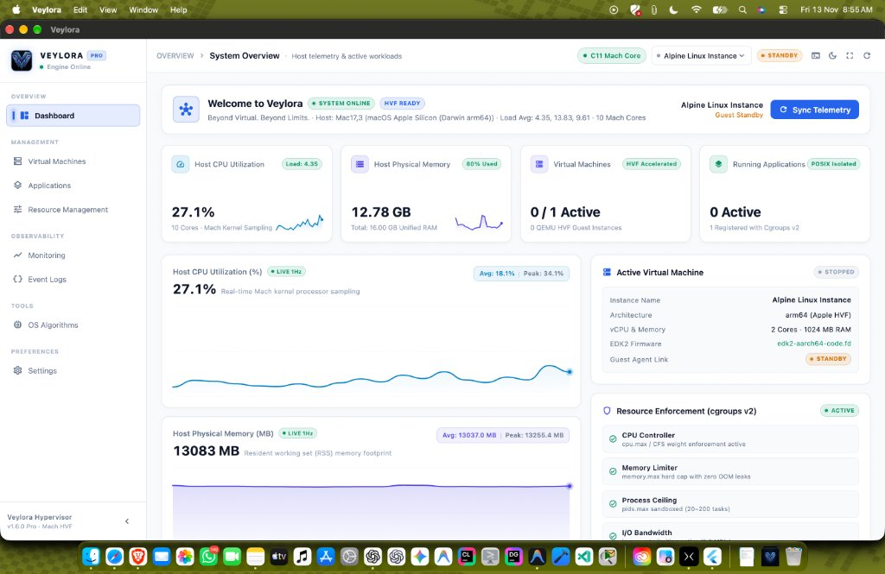

* **Real-Time Host Telemetry**: Native Mach kernel sampling (`mach_host_statistics64()`) captures CPU utilization, user/system breakdown, physical RAM occupancy, and 1-min/5-min/15-min run-queue load averages.
* **Continuous Time-Series Sparklines & Charts**: Interactive rolling charts with automatic average and peak load detection.
* **Instant Hypervisor Status**: Hardware-accelerated HVF subsystem state, EDK2 UEFI firmware health, and guest communication status at a glance.

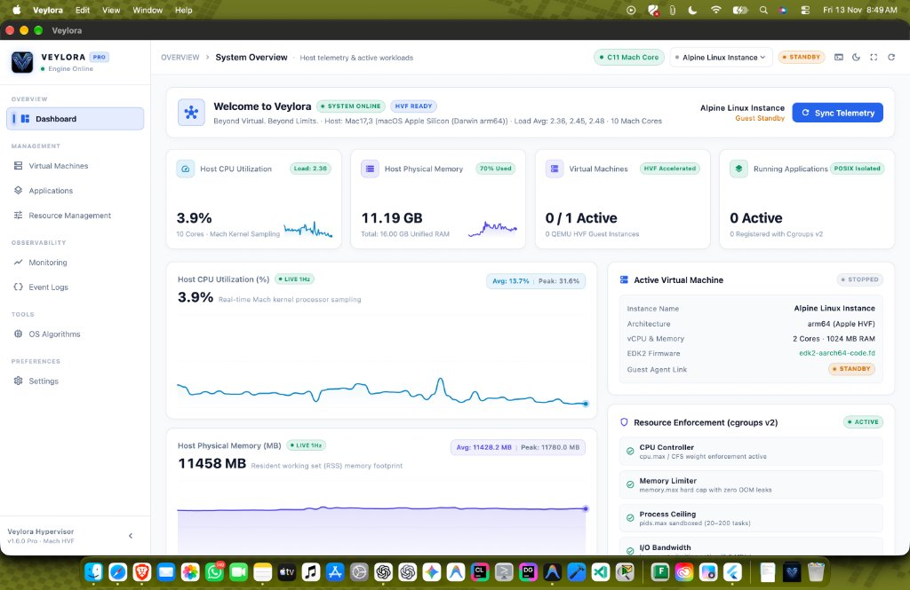
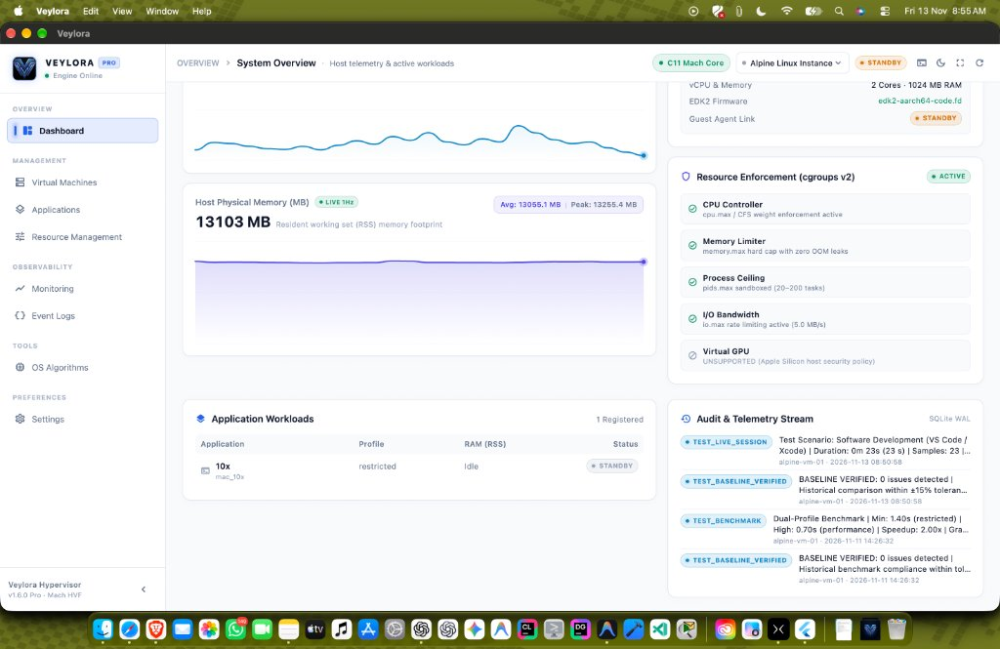

---

### 2. Virtual Machine Management (macOS HVF & Linux KVM)
Veylora manages full-system virtual machines with near-bare-metal performance using Apple Silicon Hypervisor Framework (HVF) on macOS and Kernel-based Virtual Machine (KVM) on Linux.

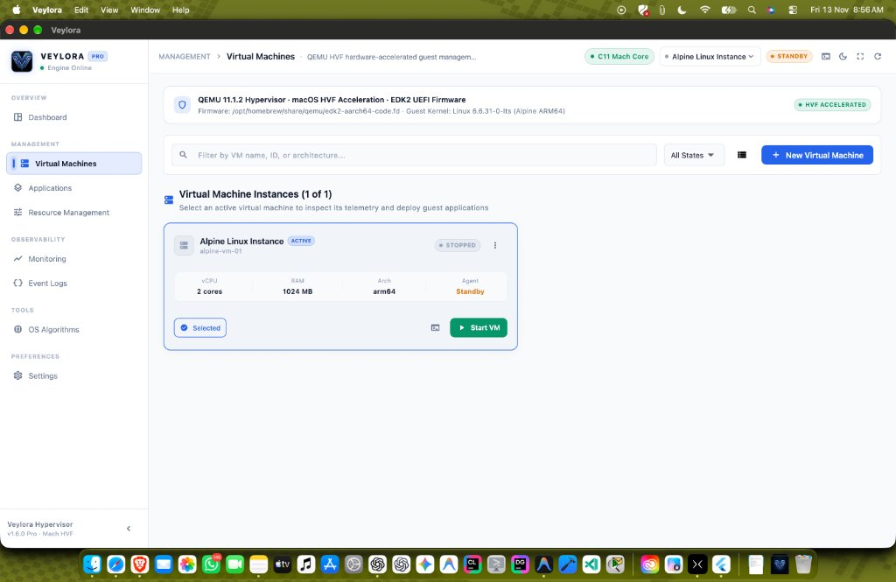

* **Zero-Overhead Hardware Acceleration**: Direct vCPU execution without software CPU emulation traps.
* **Firmware & Boot Architecture**: Automated detection and binding of EDK2 UEFI firmware (`edk2-aarch64-code.fd`) supporting modern 64-bit Linux kernels (Alpine Linux, Ubuntu, Debian).
* **Virtio Transport Channels**: Bidirectional virtio-serial socket protocol connecting the host hypervisor to the in-guest Veylora Guest Agent for zero-network management.
* **Safe Process Lifecycle**: Graceful SIGTERM teardown, automatic child reaping, PID reuse validation, and crash recovery.

---

### 3. Application Lifecycle & Sandboxed Execution
Veylora allows developers and sysadmins to register, launch, benchmark, and govern applications within isolated Linux cgroups v2 control hierarchies.

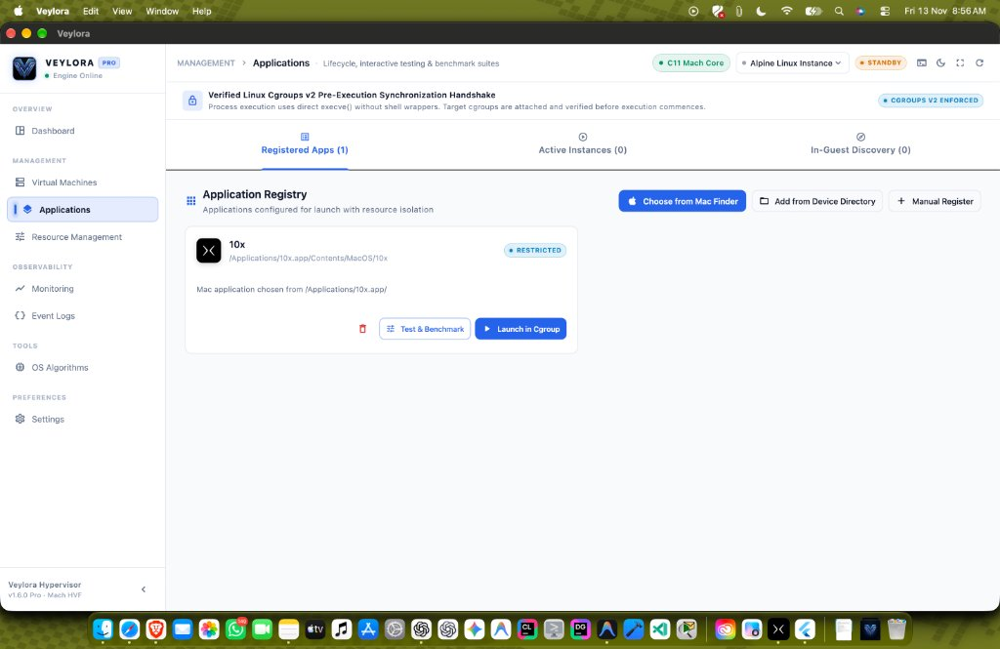

* **Native Finder & File Browser Integration**: Direct selection of host or guest executables.
* **Shell-Injection Proof Handshake**: Direct execution via `execve()` bypassing shell interpreters to eliminate shell-escape vulnerabilities.
* **Automated Benchmarking Suite**: Dual-profile comparison testing (Restricted vs. Performance profiles) measuring wall-clock speedup, CPU cycles, and memory footprint.
* **Automated Comparative Issue Reports**: Execution telemetry is compared against historical baselines; variances exceeding $\pm 15\%$ automatically generate an `issues.txt` compliance report.

---

### 4. Fine-Grained Resource Governance (Linux Cgroups v2)
Manage compute envelopes with fine-grained kernel control limits. Veylora implements direct kernel readback verification to ensure applied quotas match hardware enforcement.

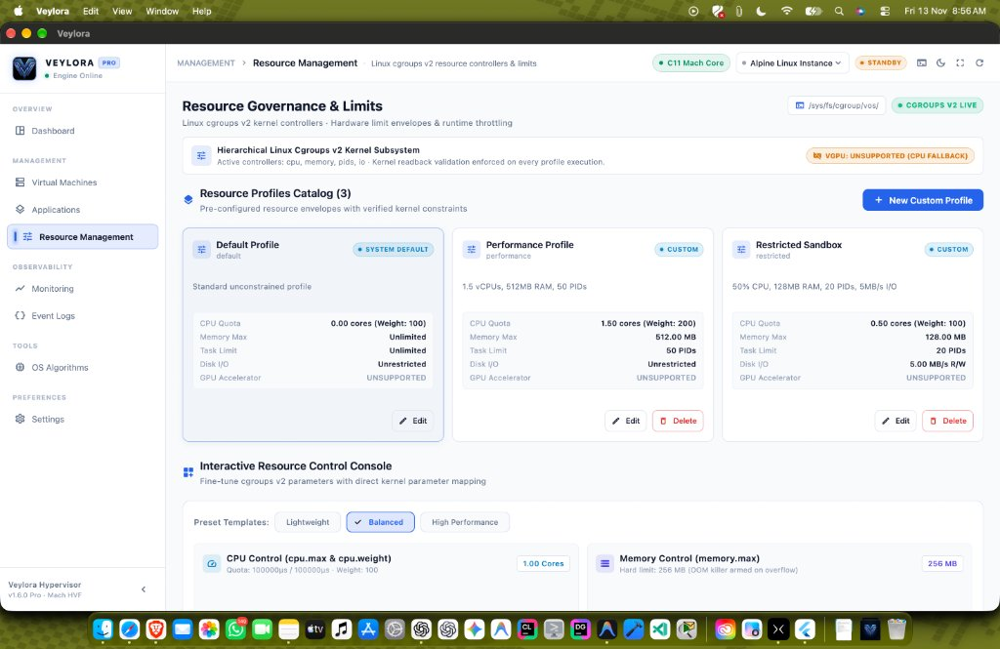
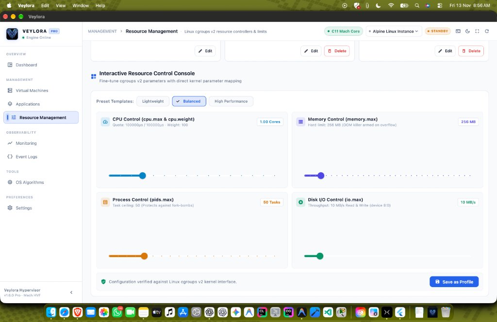

* **Pre-Configured & Custom Profiles**: Choose from Default, Balanced, Performance, or Restricted Sandbox profiles, or author custom kernel envelopes.
* **CPU Control (`cpu.max` & `cpu.weight`)**: Hardware quotas specified as microseconds per period (e.g., 50,000µs / 100,000µs = 50% CPU cap) and CFS scheduler weights (1–10000).
* **Memory Control (`memory.max`)**: Strict memory ceilings with automated OOM-killer trigger protection and zero memory leak guarantees.
* **Process Ceiling (`pids.max`)**: Hard limits on maximum concurrent tasks to eliminate fork-bombs and runaway processes.
* **Disk I/O Bandwidth Throttling (`io.max`)**: Dynamic major:minor block device discovery (`/sys/dev/block`) enforcing strict read/write byte ceilings (e.g., 5 MB/s).

---

### 5. Multi-Layer Observability & Telemetry
Veylora structures system telemetry across 4 discrete layers, isolating host resource dynamics from guest workload consumption.

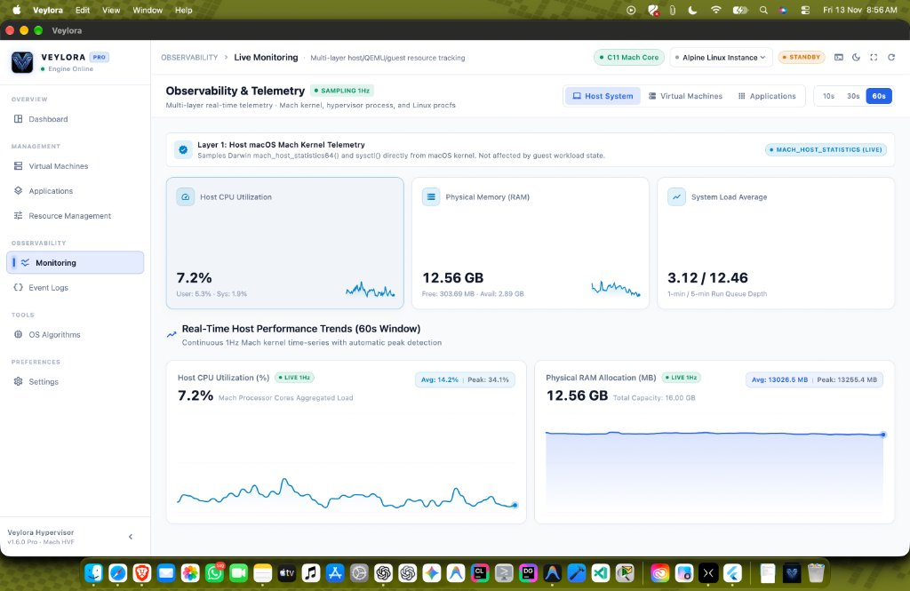
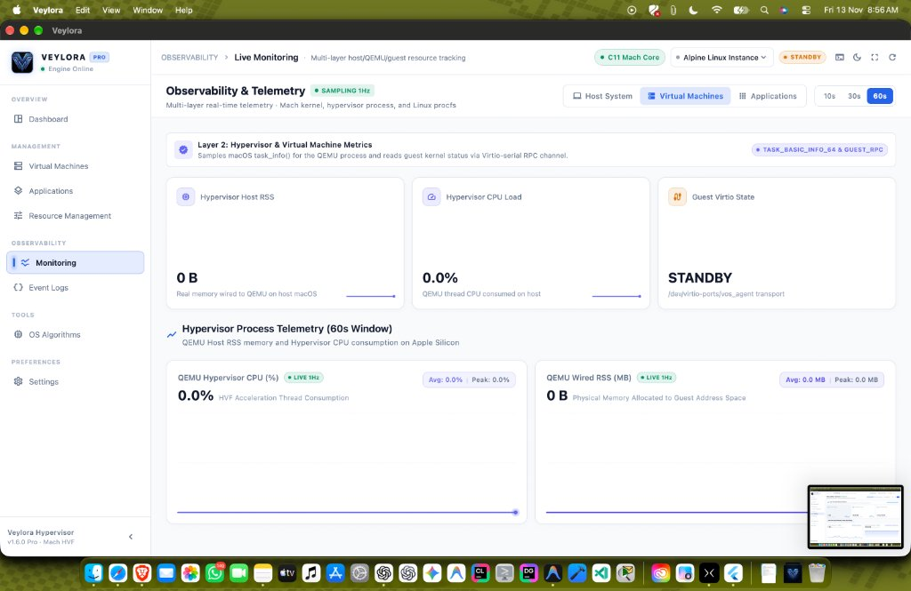
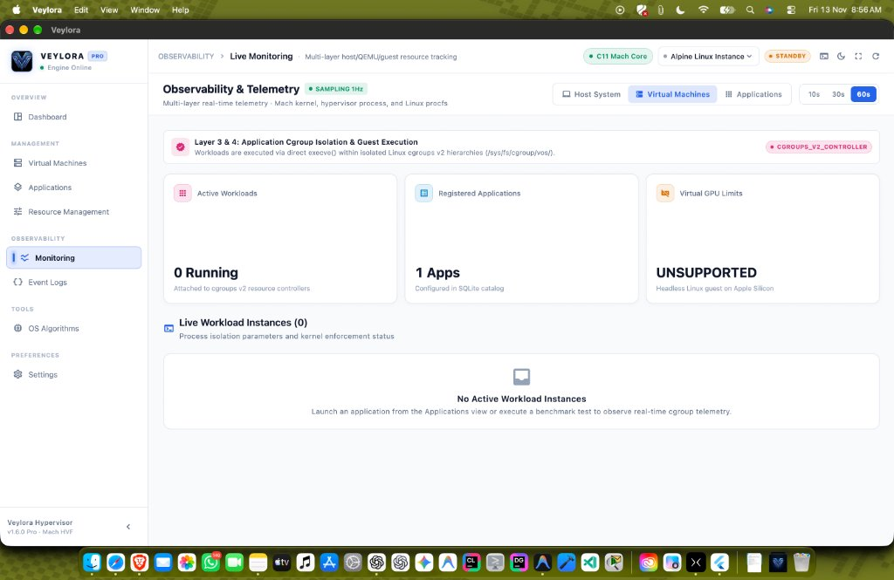

* **Layer 1 — Host Kernel**: Darwin Mach kernel telemetry measuring total hardware cores, resident physical RAM footprint, and load average trends.
* **Layer 2 — Hypervisor Process**: Dedicated `task_info()` sampling tracking QEMU process RSS memory and host thread CPU consumption.
* **Layer 3 — Virtio Transport Channel**: Real-time heartbeat and RPC status with the in-guest agent.
* **Layer 4 — In-Guest Workload Isolation**: Telemetry sampled from `/proc` and `/sys/fs/cgroup/vos/` inside the virtual environment.

---

### 6. Immutable SQLite Audit Trail & Event Logs
Every system action, VM lifecycle transition, application launch, and benchmark run is preserved in an immutable, WAL-mode SQLite database.

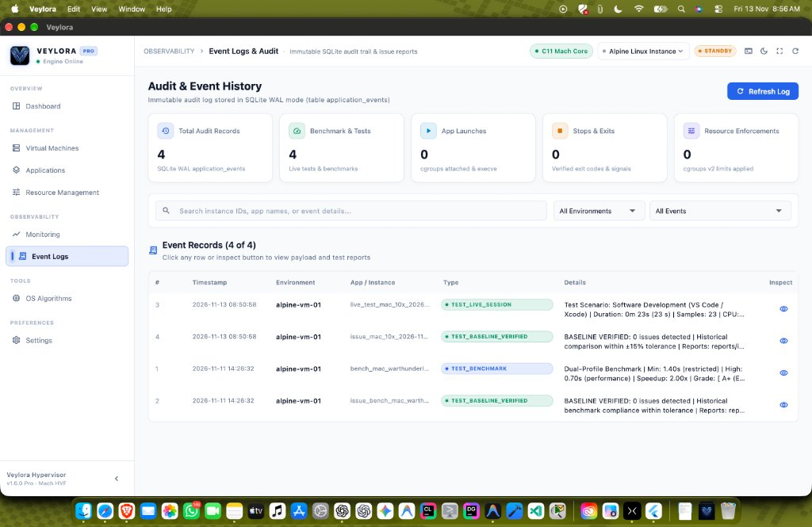

* **Forensic Audit Records**: Timestamped logging of environment IDs, PID numbers, exit codes, and resource limit profiles.
* **Detailed Payload Inspector**: Full JSON execution logs and benchmark grade readouts accessible with a single click.
* **Exportable Reports**: Direct export of technical performance reports and non-technical summary ledgers to the user's Downloads directory.

---

### 7. Theoretical Operating System Algorithm Simulator
In addition to live hypervisor management, Veylora includes a comprehensive, educational OS algorithm sandbox written in pure C11.

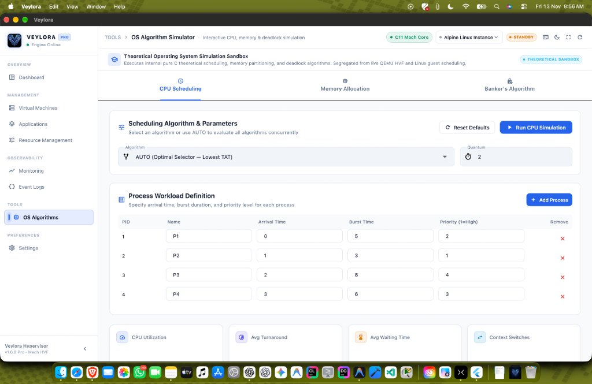
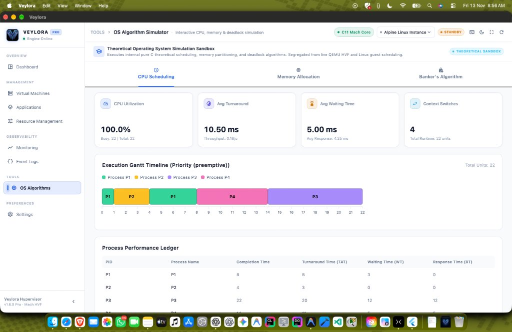

* **CPU Scheduling Engine**: Simulates and compares 6 classical CPU algorithms:
  * **FCFS** (First-Come, First-Served)
  * **SJF** (Shortest Job First - Non-Preemptive)
  * **SRTF** (Shortest Remaining Time First - Preemptive)
  * **Priority (Non-Preemptive)**
  * **Priority (Preemptive)**
  * **Round Robin** (Configurable Time Quantum $q$)
* **Intelligent AUTO Selector**: Evaluates workload variance, priority spreads, and arrival times to automatically pick the optimal algorithm minimizing Turnaround Time (TAT) and Waiting Time (WT).
* **Interactive Gantt Timeline**: Color-coded, unit-accurate Gantt visualizer with context switch tracking.
* **Process Performance Ledger**: Instant calculation of Arrival, Burst, Finish, Turnaround, Waiting, and Response Times for each process.
* **Memory Partition Allocator**: Simulates **First Fit**, **Best Fit**, and **Worst Fit** partition allocation policies with real-time internal fragmentation accounting.
* **Dijkstra's Banker's Algorithm**: Complete deadlock avoidance engine computing Allocation, Maximum, and Need matrices to derive a mathematically proven Safe Sequence or issue deadlock warnings.

---

## Architectural Breakdown

```
 ┌─────────────────────────────────────────────────────────────┐
 │                VEYLORA FLUTTER DESKTOP UI                   │
 │   Dashboard  •  VM Manager  •  Apps  •  Cgroups  •  Audit   │
 └──────────────────────────────┬──────────────────────────────┘
                                │ Dart FFI (Foreign Function Interface)
 ┌──────────────────────────────▼──────────────────────────────┐
 │             C11 FFI GATEWAY (libvos_backend.dylib)          │
 │   vos_api_init()   •   vos_api_vm_*()   •   vos_api_app_*() │
 └──────┬───────────────────────┼───────────────────────┬──────┘
        │                       │                       │
 ┌──────▼─────────────┐  ┌──────▼─────────────┐  ┌──────▼─────────────┐
 │  HYPERVISOR CORE   │  │ RESOURCE & CGROUP  │  │ SIMULATION ENGINE  │
 │  QEMU 11+ HVF/KVM  │  │ Cgroups v2 Manager │  │ CPU Scheduler      │
 │  EDK2 UEFI Boot    │  │ App Launcher execve│  │ Memory Partitions  │
 │  Virtio-Serial RPC │  │ Telemetry Protocol │  │ Banker's Algorithm │
 └──────┬─────────────┘  └──────┬─────────────┘  └──────┬─────────────┘
        │                       │                       │
 ┌──────▼───────────────────────▼───────────────────────▼──────┐
 │                SQLITE 3.43 PERSISTENCE ENGINE               │
 │            WAL Mode  •  virtual_os.db  •  Foreign Keys      │
 └─────────────────────────────────────────────────────────────┘
```

---

## Quick Start & Installation

### Prerequisites
* **macOS**: Apple Silicon (M1/M2/M3/M4/M5) or Intel running macOS 13+
* **Flutter SDK**: 3.13+ (`brew install --cask flutter` or installed to `~/flutter`)
* **Xcode Command Line Tools**: `xcode-select --install`
* **QEMU**: `brew install qemu` (for full hardware VM orchestration)
* **Make & Clang**: Built into macOS / Xcode

---

### Launching Veylora

To build the native backend shared library and launch the Flutter desktop application:

```bash
# 1. Clone repository and navigate to frontend
cd frontend

# 2. Launch with the automated launcher script
./run.sh
```

The `./run.sh` script automatically:
1. Detects and sets the active Xcode Developer directory.
2. Checks and compiles the backend dynamic library (`libvos_backend.dylib`) if not present.
3. Stages the dynamic library and Retina application icons into the macOS application bundle.
4. Executes `flutter run -d macos`.

---

### Running the Backend C Unit Test Suites

The backend features an exhaustive C11 test suite with 100% assertion pass rates:

```bash
make test test_vm test_monitoring test_resource_enforcement test_application_management test_api
```

**Test Coverage Summary:**
* `test_core`: 256 checks — CPU schedulers, memory allocators, Banker's algorithm, SQLite CRUD.
* `test_vm`: 114 checks — QEMU detection, UEFI firmware paths, config validation, HVF integration.
* `test_monitoring`: 197 checks — Mach host telemetry, JSON wire protocol, cgroup limits, concurrency.
* `test_resource_enforcement`: 197 checks — Cgroup identifier safety, dynamic block device lookups, I/O limits.
* `test_application_management`: 156 checks — RPC wire protocol, `execve` pre-execution handshakes, PID reuse protection.
* `test_api`: 43 checks — Shared library FFI gateway validation, end-to-end audit logging.
* **Total: 766 automated checks, 0 failures.**

---

### Running Flutter Frontend Tests

Verify the desktop UI component rendering, overflow protections, and state transitions:

```bash
cd frontend
flutter analyze
flutter test
```

---

## Alternative C11 Native Interfaces

For headless environments, servers, or lightweight terminal setups, Veylora retains its native C executables:

* **Hardware-Accelerated Nuklear SDL2 GUI**:
  ```bash
  make sdl
  ./virtual_os_sdl
  ```
* **Interactive Terminal CLI**:
  ```bash
  make cli
  ./virtual_os_cli
  ```

---

## Project Structure

```
VirtualOS_Simulator/
├── Makefile                       # Multi-platform Makefile (macOS, Linux, Windows)
├── CMakeLists.txt                 # Modern CMake build configuration
├── CODE_EXPLANATION.md            # Deep mathematical and algorithmic documentation
├── README.md                      # Product overview and documentation (this file)
├── include/
│   └── vos_api.h                  # High-performance C FFI Gateway header
├── src/
│   ├── api/                       # C-ABI and FFI bridge implementation
│   ├── application/               # Application registry, launcher, and cgroups v2
│   ├── cli/                       # Terminal CLI interface
│   ├── core/                      # Pure C11 scheduling, memory, Banker's engine
│   ├── db/                        # SQLite 3 WAL persistence engine
│   ├── gui_sdl/                   # Immediate-mode Nuklear + SDL2 GUI
│   ├── monitoring/                # Mach kernel & host/guest resource monitoring
│   └── virtualization/            # QEMU HVF hypervisor and UEFI VM manager
├── guest_agent/                   # Portable in-guest Linux monitoring agent
├── vm_images/                     # UEFI Alpine Linux kernel & disk images
├── tests/                         # 766 automated C unit & integration tests
├── docs/
│   └── screenshots/               # Full suite of Veylora HD screenshots
└── frontend/                      # Premium Flutter Desktop SaaS Application
    ├── lib/                       # Screens, widgets, controllers, and design system
    ├── macos/                     # Native macOS Runner, entitlements, and Retina icons
    ├── test/                      # Flutter UI and responsive rendering test suite
    ├── pubspec.yaml               # Flutter package specification
    └── run.sh                     # Automated macOS build and execution script
```

---

## License

This project is licensed under the MIT License. See `LICENSE` for details.
SQLite is public domain. Nuklear is dual public domain / MIT.
