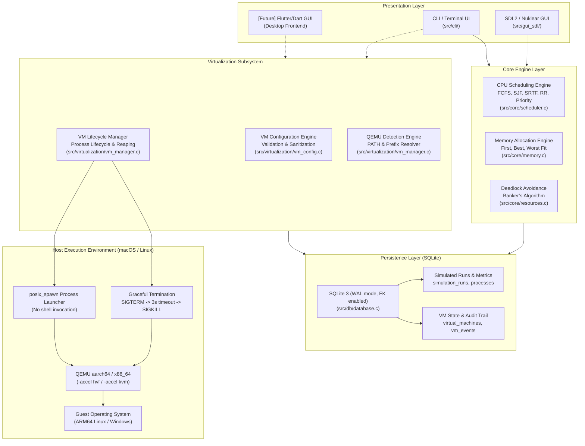

# Virtual OS Simulator – Architecture Specification

## 1. Executive Summary & Design Philosophy

**Virtual OS Simulator** is an operating system engineering platform combining two complementary domains:
1. **Academic OS Simulation Engine**: Deterministic, algorithmic simulation of fundamental OS mechanisms (CPU scheduling, memory allocation, and deadlock avoidance via Banker's algorithm).
2. **Real Virtual Machine Management Backend**: Safe, isolated hypervisor process orchestration managing physical QEMU guest virtual machines, persistent lifecycle tracking in SQLite, and extensible IPC interfaces for modern frontends.

A foundational architectural principle of this project is the **strict separation between simulated algorithms and real hypervisor control**:
* The scheduling algorithms (FCFS, SJF, SRTF, Priority, Round Robin, Auto) and memory allocation algorithms (First Fit, Best Fit, Worst Fit) operate in a deterministic simulation model for academic study.
* They do **not** govern or preempt host kernel scheduling or guest OS kernel paging. Real guest operating systems execute their own internal schedulers and memory managers on top of virtualized hardware provided by QEMU and the host hypervisor (Hypervisor.framework on macOS).

---

## 2. System Architecture

---

## 3. Layer Breakdown & Responsibilities

### 3.1. Core Simulation Layer (`src/core/`)
* **`scheduler.c`**: Implements classic process scheduling algorithms:
  * **FCFS**: First-Come, First-Served non-preemptive queue.
  * **SJF**: Shortest Job First non-preemptive execution.
  * **SRTF**: Shortest Remaining Time First preemptive scheduling.
  * **Priority**: Priority-based scheduling with priority-inversion analysis.
  * **Round Robin**: Time-sliced quantum preemption.
  * **Auto Scheduler**: Heuristic analyzer recommending optimal algorithm based on workload variance, quantum sensitivity, and process counts.
* **`memory.c`**: Implements simulated contiguous memory allocation strategies (First Fit, Best Fit, Worst Fit) and internal/external fragmentation calculations.
* **`resources.c`**: Implements resource allocation matrices and Dijkstra's Banker's algorithm for multi-resource deadlock avoidance.
* **`util.c`**: High-resolution performance timers, string utilities, and memory safety wrappers.

### 3.2. Virtualization Layer (`src/virtualization/`)
* **`vm_config.h` / `vm_config.c`**:
  * Complete model representing guest configuration (`VmConfig`).
  * Field sanitization and validation: ID character whitelisting `[a-zA-Z0-9_-]`, CPU count bounded to host capabilities `[1, 64]`, guest memory limits `[128 MB, host RAM 90%]`, guest architectures (`ARM64`, `x86_64`).
  * Image format validation: verifies `.iso`, `.qcow2`, `.raw`, `.img` extensions and ensures file existence.
  * Configurable display backends (`VM_DISPLAY_NONE`, `VM_DISPLAY_COCOA`, `VM_DISPLAY_SDL`, `VM_DISPLAY_VNC`).
  * Configurable network modes (`VM_NET_NONE`, `VM_NET_USER` SLIRP NAT).
  * Format string injection, shell metacharacter, and path traversal rejection.
* **`vm_manager.h` / `vm_manager.c`**:
  * Hypervisor discovery: Scans system `PATH` and Apple Silicon Homebrew paths (`/opt/homebrew/bin`, `/usr/local/bin`) for `qemu-system-aarch64`.
  * EDK2 UEFI Firmware discovery: Resolves `/opt/homebrew/share/qemu/edk2-aarch64-code.fd` on Apple Silicon macOS to provide required UEFI boot services for ARM64 `-M virt`.
  * Safe execution: Direct argument vector construction without invoking `/bin/sh` or `system()`. Avoids shell expansion risks.
  * Process management via `posix_spawn()`: Launches QEMU child processes in isolated process groups with stdout and stderr redirected to dedicated per-VM console logs (`<work_dir>/<vm_id>_console.log`).
  * Immediate 150ms startup probe: Non-blocking `waitpid(WNOHANG)` catches immediate QEMU startup aborts, reads console error snippets, and transitions state to `failed` immediately.
  * Two-phase graceful shutdown: Sends `SIGTERM` to the guest process group, awaits termination within a configurable millisecond timeout (default 5000ms), and escalates to `SIGKILL` only if the guest remains unresponsive.
  * Non-blocking child reaping via `vm_reap_children()` to track unexpected exits and capture error diagnostics.
  * Stale state reconciliation: `vm_manager_reconcile_db()` reconciles stale `running`/`starting` states across simulator restarts or OS crashes against active PIDs (`kill(pid, 0)`).

### 3.3. Database Persistence Layer (`src/db/`)
* **`database.c` / `database.h`**:
  * Unified SQLite database (`virtual_os.db`).
  * Enforces foreign key constraints (`PRAGMA foreign_keys = ON;`) and Write-Ahead Logging (`PRAGMA journal_mode = WAL;`).
  * Prepared statements for all data mutations and queries to prevent SQL injection.
  * Non-destructive schema migrations for existing installations.
  * **`virtual_machines` table**:
    * `id INTEGER PRIMARY KEY AUTOINCREMENT`
    * `vm_id TEXT NOT NULL UNIQUE`
    * `name TEXT NOT NULL`
    * `guest_arch TEXT NOT NULL`
    * `os_image_path TEXT NOT NULL`
    * `cpu_count INTEGER NOT NULL`
    * `memory_mb INTEGER NOT NULL`
    * `disk_image_path TEXT NOT NULL DEFAULT ''`
    * `display TEXT NOT NULL DEFAULT 'none'`
    * `net TEXT NOT NULL DEFAULT 'user'`
    * `work_dir TEXT NOT NULL DEFAULT '.'`
    * `status TEXT NOT NULL DEFAULT 'created'`
    * `created_at DATETIME DEFAULT (datetime('now','localtime'))`
    * `updated_at DATETIME DEFAULT (datetime('now','localtime'))`
  * **`vm_events` table**:
    * `id INTEGER PRIMARY KEY AUTOINCREMENT`
    * `vm_db_id INTEGER NOT NULL REFERENCES virtual_machines(id) ON DELETE CASCADE`
    * `event_type TEXT NOT NULL`
    * `message TEXT NOT NULL DEFAULT ''`
    * `created_at DATETIME DEFAULT (datetime('now','localtime'))`
    * Indexed by `idx_vm_events_vm` on `vm_db_id`.

### 3.4. Monitoring & Resource Management Subsystem (`src/monitoring/`)
* **`host_monitor.c` / `host_monitor.h`**:
  * Direct macOS Mach microkernel host statistics (`mach_host_self()`, `HOST_CPU_LOAD_INFO`, `HOST_VM_INFO64`).
  * Gathers host CPU total, user, system, idle ticks, physical RAM breakdown (active, inactive, wired, compressed).
  * Direct process inspection via `proc_pidinfo(PROC_PIDTASKINFO)` for target QEMU processes (RSS RAM, user/system CPU execution nanoseconds).
* **`agent_protocol.c` / `agent_protocol.h`**:
  * Compact JSON telemetry serializer and zero-heap parser.
  * Validates sequence counters, timestamps, protocol versions, and strict validation.
* **`process_monitor.c` / `process_monitor.h`**:
  * Application classifier assigning processes to categories (`Creative`, `DevTools`, `Browser`, `System`, `Other`).
  * Filtering by PID, command substring, category, minimum CPU %, and top-resource ranking.
* **`resource_limits.c` / `resource_limits.h`**:
  * VM hardware boundary verification (`-smp`, `-m`).
  * Linux cgroups v2 resource capping (`cpu.max`, `cpu.weight`, `memory.max`) in `/sys/fs/cgroup/virtualos/<pid>/`.
  * Mandatory PID 1 and system daemon protection against accidental constraint.
  * Host QEMU scheduling priority adjustment via `setpriority(PRIO_PROCESS)`.
* **`vm_monitor.c` / `vm_monitor.h`**:
  * Independent background sampling worker threads with configurable intervals (default 1000ms).
  * Non-blocking virtio-serial UNIX domain socket polling (`/tmp/vos_agent_<vm_id>.sock`).
  * Unambiguous metric source attribution (`METRIC_SOURCE_HOST`, `METRIC_SOURCE_GUEST`, `METRIC_SOURCE_COMBINED`).
  * SQLite persistence for `resource_samples`, `process_samples`, and `resource_limits`.

---

## 4. Security & Isolation Architecture

1. **Host Boundary Defense**:
   * Guest configurations default to strictly isolated virtual machines.
   * Host directories are **never** mounted automatically into the guest.
   * VM disk images are quarantined in user-designated workspace directories.
2. **Process Privilege Isolation**:
   * QEMU runs unprivileged as the standard user. Never invoke with `sudo` or elevated privileges.
   * Direct argument arrays via `posix_spawn()` eliminate shell injection and environment leakage.
   * Networking defaults to unprivileged User-mode NAT (SLIRP) via virtio-net-pci; no bridge interfaces or root capabilities required.
3. **Command Injection Prevention**:
   * Never pass VM parameters through `system()` or shell formatting. All CLI arguments are array-marshaled directly into `char *argv[]`.

---

## 5. Extensibility: Alternative Virtualization Backends

The `VmManager` interface is designed to support modular virtualization drivers:
* **Current Driver (Phase 2)**: QEMU CLI driver (`qemu-system-aarch64` with `-accel hvf`).
* **Future macOS Driver**: Direct Apple `Virtualization.framework` (`VZVirtualMachine`) via an Objective-C / Swift bridging layer for hardware-accelerated Metal GUI pass-through and lightweight virtualization on Apple Silicon.
* **Future Frontend**: Flutter/Dart UI communicating via C-API / FFI to manage VMs, display real-time metrics, and view guest desktop sessions.

