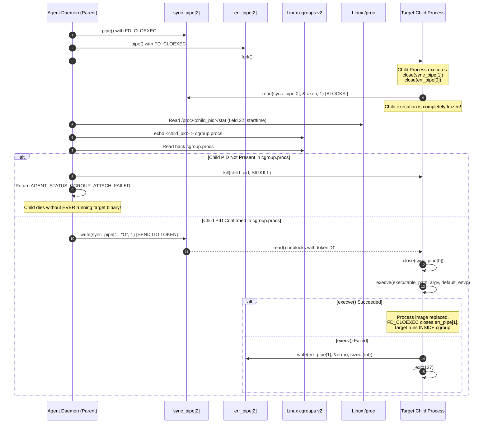

# Guest Application Pre-Execution Launch Handshake Specification

**Project**: Virtual OS Simulator  
**Subsystem**: Guest Agent Application Launcher (`guest_agent/src/app_launcher.c`)  
**Guest Environment**: Alpine Linux ARM64 (Linux Kernel `6.6.31-0-lts`)  
**Security Contract**: ZERO UNBOUNDED CODE EXECUTION  
**Status**: ACTIVE  

---

## 1. Problem Statement: The Post-Fork Cgroup Race Condition

In naive process execution models, process launching and cgroup enforcement typically follow this sequence:
1. Process manager calls `fork()`.
2. Child process immediately calls `execve()` and starts running user code.
3. Concurrently, the parent process attempts to write the child's PID into `/sys/fs/cgroup/.../cgroup.procs`.

### The Critical Vulnerability
Between step 2 and step 3, an unpredictable scheduling delay occurs. An adversary or poorly-configured application can:
* Allocate 100% of host CPU or guest memory during startup initialization.
* Fork hundreds of background worker threads before `pids.max` is attached.
* Cause an Out-Of-Memory panic in the guest before `memory.max` is active.

In Virtual OS Simulator, **unbounded execution is unacceptable**. Applications must be strictly bound to their cgroup limits before the first instruction of the target executable is ever executed.

---

## 2. The Pre-Execution Handshake Protocol

Virtual OS Simulator resolves this race condition through a **dual POSIX synchronization pipe protocol**:
* `sync_pipe[2]`: Used by the parent agent to hold the child in a blocking read until cgroup assignment is verified.
* `err_pipe[2]`: Used by the child to communicate execve failures back to the parent.

Both pipe descriptors are initialized with the `FD_CLOEXEC` flag so they automatically close upon a successful `execve()`.



---

## 3. Implementation Walkthrough (`guest_agent/src/app_launcher.c`)

### 3.1 Pipe Initialization & Cloexec
```c
int sync_pipe[2];
int err_pipe[2];
if (pipe(sync_pipe) != 0 || pipe(err_pipe) != 0) {
    return AGENT_STATUS_INTERNAL_ERROR;
}

fcntl(sync_pipe[0], F_SETFD, FD_CLOEXEC);
fcntl(sync_pipe[1], F_SETFD, FD_CLOEXEC);
fcntl(err_pipe[0], F_SETFD, FD_CLOEXEC);
fcntl(err_pipe[1], F_SETFD, FD_CLOEXEC);
```

### 3.2 Safe In-Memory Argument Parsing Without Shell Interpretation
To eliminate shell injection vulnerabilities, application arguments are parsed in-memory using `app_parse_args()` into a standard `char *argv[]` array without invoking `/bin/sh -c`, `bash -c`, `system()`, `popen()`, or `eval`:
```c
int argc = app_parse_args(executable_path, args_str, argv, 32, scratch, sizeof(scratch));
// Preserves quoted strings with spaces (--msg="hello world")
// Retains shell metacharacters (;, $, |, &, `, <, >) as literal data
```

### 3.3 Child Process Synchronization & Direct `execve()`
In the child branch of `fork()`:
```c
close(sync_pipe[1]);
close(err_pipe[0]);

/* Block until parent attaches cgroup and writes token 'G' */
char token = 0;
ssize_t n = read(sync_pipe[0], &token, 1);
close(sync_pipe[0]);

if (n <= 0 || token != 'G') {
    /* Attachment failed or parent aborted child */
    _exit(125);
}

/* Sanitized default environment for the guest process */
char *default_envp[] = {
    "PATH=/bin:/usr/bin:/sbin:/usr/sbin:/usr/local/bin",
    "HOME=/root",
    "TERM=linux",
    "USER=root",
    "LOGNAME=root",
    NULL
};

/* Execute target binary directly via sys_execve */
execve(executable_path, argv, default_envp);

/* If reached, execve failed */
int err = errno;
write(err_pipe[1], &err, sizeof(err));
close(err_pipe[1]);
_exit(127);
```

### 3.4 Parent Inspection & Attachment
In the parent branch of `fork()`:
```c
close(sync_pipe[0]);
close(err_pipe[1]);

/* 1. Extract process start time from /proc/<pid>/stat */
uint64_t start_time = 0;
cgroup_read_process_starttime(cgroup_root, child_pid, &start_time);

/* 2. Attach to target cgroup */
cgroup_attach_process_with_identity(cgroup_root, group_id, child_pid, start_time, err_buf, err_sz);

/* 3. Read back cgroup.procs to confirm kernel acceptance */
if (!cgroup_verify_pid_in_group(cgroup_root, group_id, child_pid)) {
    /* Kill child before it ever runs */
    kill(child_pid, SIGKILL);
    close(sync_pipe[1]);
    close(err_pipe[0]);
    return AGENT_STATUS_CGROUP_ATTACH_FAILED;
}

/* 4. Release child to execute */
write(sync_pipe[1], "G", 1);
close(sync_pipe[1]);

/* 5. Check err_pipe for execve failures */
int child_err = 0;
if (read(err_pipe[0], &child_err, sizeof(child_err)) > 0) {
    close(err_pipe[0]);
    return AGENT_STATUS_LAUNCH_FAILED;
}
close(err_pipe[0]);
```

---

## 4. Empirical Verification

During live testing with `scratch/demo_phase5_app_lifecycle.c` under Alpine Linux ARM64:
1. Child PID `2342` was spawned.
2. `cat /sys/fs/cgroup/virtualos/applications/app_busybox_worker/cgroup.procs` returned `2342`.
3. `cat /sys/fs/cgroup/virtualos/applications/app_busybox_worker/pids.current` returned `1`.
4. The worker executed a CPU loop, and the Linux CFS scheduler reported:
   - `nr_periods`: 20
   - `nr_throttled`: 19
   - `throttled_usec`: 952635
   Proving that the process was restricted by the cgroup from its very first clock tick.

