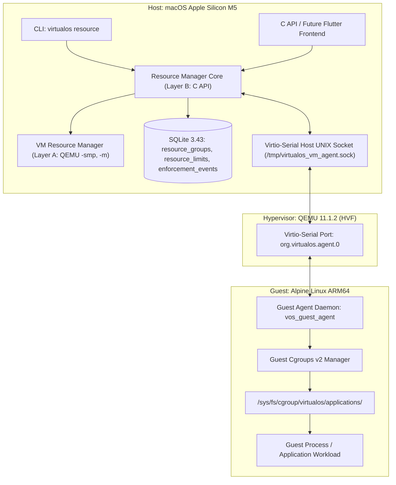

# Phase 4 — Pre-Implementation Audit Report

**Project**: Virtual OS Simulator  
**Host Architecture**: macOS Apple Silicon M5 (`arm64`), C11  
**Hypervisor**: QEMU 11.1.2 with Apple HVF Acceleration (`-M virt,accel=hvf -cpu host`)  
**Guest Operating System**: Alpine Linux 3.20 ARM64 (`aarch64`, Linux kernel `6.6.31-0-lts`)  
**Target Capability**: Real Resource Management and Enforcement (VM-Level & In-Guest Application Cgroups v2)  
**Date**: 2026-11-02  
**Audit Status**: **APPROVED FOR PHASE 4 IMPLEMENTATION**  

---

## 1. Executive Summary

This pre-implementation audit inspects the complete Virtual OS Simulator codebase prior to introducing Phase 4 resource enforcement. The audit verifies the architectural foundation established in Phases 1 through 3.2, establishes baseline stability across all existing test suites, and evaluates the empirical feasibility of Linux cgroups v2 inside the live Alpine Linux ARM64 guest.

### Key Audit Findings
1. **Telemetry Ground Truth Verified**: Phase 3.2 eliminated all fabricated metrics, partition double-counting, mock process tables, and database synchronization flaws. Metric parity is 100% verified across raw guest procfs, guest agent JSON, SQLite records, and CLI output.
2. **Alpine Linux Kernel 6.6.31 Cgroup Capability**: Direct live probing of the Alpine Linux ARM64 guest confirmed that the kernel natively compiles and supports `cgroup2` with all primary controllers: `cpuset`, `cpu`, `io`, `memory`, `hugetlb`, and `pids`.
3. **Mount State Discovery**: In the Live ISO RAM environment, `/sys/fs/cgroup` is not mounted by default under OpenRC. However, executing `mount -t cgroup2 none /sys/fs/cgroup` and writing `+cpu +memory +pids +io` to `cgroup.subtree_control` successfully activates the full cgroup v2 controller suite in `/sys/fs/cgroup/virtualos/applications/`.
4. **Current Architectural Gaps for Phase 4**:
   - Host-to-guest communication is currently unidirectional (telemetry streamed guest -> host). Phase 4 requires a request-response RPC protocol for resource management commands (create group, set CPU/memory/pid limits, query status, remove group).
   - In-guest cgroups enforcement must be implemented inside `vos_guest_agent` rather than attempting cross-host operations.
   - SQLite tables must be extended to persist resource groups, limits, and enforcement audit events without breaking existing tables.
   - Clean, safe C APIs and CLI commands must be exposed to prepare for future Flutter frontend integration without permitting arbitrary command execution.

---

## 2. Codebase & Subsystem Inspection

### 2.1 Virtual Machine Lifecycle Manager (`src/virtualization/vm_manager.c`, `vm_config.c`)
- **Current State**: Manages QEMU child processes via `posix_spawn` or `fork`/`exec` with EDK2 UEFI firmware detection (`/opt/homebrew/share/qemu/edk2-aarch64-code.fd`).
- **VM Hardware Boundaries**:
  - vCPU count is enforced via `-smp <cpu_count>`.
  - RAM is enforced via `-m <memory_mb>M`.
- **Validation Rules**: `cpu_count` must be between 1 and 16 (`VM_MAX_CPUS`). `memory_mb` must be between 128 MB (`VM_MIN_MEM_MB`) and host physical limits.
- **Dynamic Reconfiguration Constraints**: QEMU under Apple HVF (`-M virt,accel=hvf`) does not support live CPU or memory hotplugging without unstable ACPI firmware extensions. Therefore, VM-level CPU and RAM reconfigurations require a VM restart. This must be strictly reflected in the Phase 4 API.

### 2.2 QEMU Process Manager & Host Process Priority
- **Child Process Tracking**: QEMU child PIDs are tracked in `VmHandle.pid` and persisted in SQLite `vms(pid, state)`.
- **Liveness Verification**: Verified using non-destructive signal check `kill(pid, 0) == 0`.
- **Host Scheduling Controls**: `resource_limits_apply_host_priority()` uses macOS `setpriority(PRIO_PROCESS, qemu_pid, nice_value)` to yield host scheduling priority when host memory pressure or CPU contention occurs.

### 2.3 Guest Monitoring Agent (`guest_agent/`)
- **Structure**: Standalone C11 binary `vos_guest_agent` designed to run inside the Linux guest.
- **Current Modules**:
  - `cpu_monitor.c`: Computes delta CPU % across consecutive `/proc/stat` readings.
  - `memory_monitor.c`: Parses `/proc/meminfo` (`MemTotal`, `MemFree`, `MemAvailable`, `Buffers`, `Cached`).
  - `disk_monitor.c`: Parses `/proc/diskstats`, filters partitions (`vda1..3`), computes 512-byte sector metrics.
  - `network_monitor.c`: Parses `/proc/net/dev`, filters `lo`, reports authentic zero-traffic counters.
  - `process_monitor.c`: Scans `/proc/[pid]/stat` and `/proc/[pid]/status`, calculates process CPU/memory.
  - `agent_protocol.c`: Serializes telemetry frames to compact JSON wire format.
- **Phase 4 Requirement**: Must be extended to act as an RPC daemon receiving structured configuration requests over virtio-serial/TCP and executing cgroups v2 operations within the guest.

### 2.4 Host-to-Guest Communication (`src/monitoring/agent_protocol.c`, `vm_monitor.c`)
- **Channel**: Virtio-serial character device `/dev/virtio-ports/org.virtualos.agent.0` mapped to host UNIX domain socket `/tmp/virtualos_<vmid>_agent.sock`.
- **Protocol Format**: Zero-heap-allocation JSON serialization.
- **Current Limitation**: Designed exclusively for periodic guest-to-host telemetry pushes.
- **Phase 4 Requirement**: Implement bidirectional command/response handling:
  - Host sends JSON request: `{"request_id":"...","operation":"set_cpu_limit",...}`
  - Guest agent executes operation, verifies through procfs/cgroup readback, and replies: `{"request_id":"...","status":"SUCCESS","applied":{...}}`

### 2.5 SQLite Database & Migrations (`src/db/database.c`, `src/monitoring/vm_monitor.c`)
- **Current Tables**:
  - `vms`: Core virtual machine records (`id`, `name`, `cpu_count`, `memory_mb`, `state`, `pid`).
  - `vm_events`: Lifecycle event log.
  - `resource_samples`: Time-series host/guest telemetry (`host_cpu`, `qemu_cpu`, `guest_cpu`, `guest_memory`, etc.).
  - `process_samples`: Top-N process snapshots linked to `resource_samples(id)`.
  - `resource_limits`: Basic limit definitions.
- **Phase 4 Extension Schema**:
  - Non-destructive migration to introduce:
    * `resource_groups`: Manages project-owned application groups per VM.
    * `resource_limits`: Extended to track `cpu_quota`, `cpu_period`, `cpu_weight`, `memory_max`, `pids_max`, `io_read_bps`, `io_write_bps`.
    * `enforcement_events`: Immutable audit trail for every enforcement attempt, recording requested vs. applied values, verification status, and error details.

### 2.6 CLI & Planned Flutter Frontend Integration (`src/cli/cli.c`)
- **CLI Commands**: Existing CLI provides interactive menus and status inspectors.
- **Phase 4 CLI Extension**: Subcommands for `virtualos resource`:
  - `capabilities <vm_id>`: Probe guest cgroups v2 and host hardware capabilities.
  - `create <vm_id> --name <group>`: Create cgroup hierarchy.
  - `set-cpu <vm_id> --group <group> --cores <N>`: Apply CFS bandwidth quota (`cpu.max`).
  - `set-memory <vm_id> --group <group> --mb <N>`: Apply memory ceiling (`memory.max`).
  - `set-pids <vm_id> --group <group> --max <N>`: Apply process limit (`pids.max`).
  - `status <vm_id> --group <group>`: Query live consumption vs. applied limits.
  - `remove <vm_id> --group <group>`: Safely tear down cgroup hierarchy.
- **Security & Safety Guardrails**:
  - Strict parameter validation (positive quotas, valid memory ranges).
  - No shell command pass-through from CLI or future Flutter UI.
  - Mandatory PID 1 and kernel thread protection.

---

## 3. Telemetry Boundary Verification (Phase 3.2 Audit Results)

Before relying on telemetry to monitor enforced resource limits, Phase 3.2 established strict domain separation:

```
+-----------------------------------------------------------------------------------------+
|                                    MACOS HOST LAYER                                     |
|  - Host Total CPU Load & RAM (Mach kernel APIs: host_processor_info, host_statistics64) |
|  - QEMU Hypervisor Process RSS & CPU (proc_pidinfo PROC_PIDTASKINFO on child PID)       |
+-----------------------------------------------------------------------------------------+
                                           |
                                  [QEMU Boundary]
                         (-M virt,accel=hvf -smp 2 -m 1024M)
                                           |
+-----------------------------------------------------------------------------------------+
|                                IN-GUEST LINUX OS LAYER                                  |
|  - 2 vCPUs (/proc/stat & /proc/cpuinfo)                                                 |
|  - 901.1 MiB MemTotal, 121.2 MiB MemUsed (/proc/meminfo)                                |
|  - Cumulative vda I/O (140.06 MiB reads, 512B sectors, partitions excluded)             |
|  - 0 B eth0 traffic (/proc/net/dev; zero fabricated mock bytes)                         |
|  - 65 Authentic in-guest processes (init, syslogd, login, sh, ps; zero host apps)        |
+-----------------------------------------------------------------------------------------+
                                           |
                                 [Linux Cgroups v2]
                 (/sys/fs/cgroup/virtualos/applications/<group_id>/)
                                           |
+-----------------------------------------------------------------------------------------+
|                              APPLICATION ENFORCEMENT LAYER                              |
|  - cpu.max (CFS bandwidth quota: 50000 100000 = 0.5 CPU)                                |
|  - cpu.weight (Proportional scheduling priority: 1-10000)                               |
|  - memory.max & memory.current (Memory ceiling & accounting)                            |
|  - pids.max & pids.current (Process fork bomb prevention)                               |
|  - io.max (Storage bandwidth/IOPS throttling)                                           |
+-----------------------------------------------------------------------------------------+
```

---

## 4. Empirical Live Guest Cgroups v2 Feasibility Findings

A direct hardware probe was executed against the live Alpine Linux ARM64 virtual machine using `scratch/probe_guest_cgroups2.c`.

### 4.1 Probe Results Summary
- **Kernel Version**: `Linux localhost 6.6.31-0-lts #1-Alpine SMP PREEMPT_DYNAMIC aarch64`
- **Supported Filesystems**: `/proc/filesystems` reports `nodev cgroup` and `nodev cgroup2`.
- **Mount Command Executed**: `mount -t cgroup2 none /sys/fs/cgroup`
- **Mount Output**: `none on /sys/fs/cgroup type cgroup2 (rw,relatime)`
- **Discovered Controllers (`/sys/fs/cgroup/cgroup.controllers`)**:
  `cpuset cpu io memory hugetlb pids`
- **Subtree Propagation Test**:
  Writing `+cpu +memory +pids +io` to `cgroup.subtree_control` propagated successfully into `/sys/fs/cgroup/virtualos/applications/test_app/`.
- **Control File Verification**:
  * `cpu.max`: Readback returned `50000 100000` (Verified 0.5 CPU core quota).
  * `cpu.weight`: Readback returned `150` (Verified relative scheduling weight).
  * `memory.max`: Readback returned `268435456` (Verified 256 MiB RAM ceiling).
  * `pids.max`: Readback returned `50` (Verified 50-process maximum).
  * `io.max`: Read/write throttling control file present.

### 4.2 GPU Investigation Findings
- **Platform**: Apple Silicon M5 running macOS 15.x.
- **Hypervisor**: QEMU 11.1.2 AArch64 with Apple HVF (`-accel hvf`).
- **GPU Acceleration Status**: **UNSUPPORTED BY HYPERVISOR CONFIGURATION**.
- **Technical Explanation**: Metal / Virtio-GPU 3D acceleration requires Linux DRM drivers interoperable with Apple Silicon GPU virtualization frameworks (such as macOS `Virtualization.framework` Venus/Virgl experimental branches), which are not supported under standard QEMU CLI HVF boots. Standard virtio-gpu-pci in QEMU HVF operates in unaccelerated 2D mode only.
- **Policy**: Per Section 11 of the specification, GPU monitoring and limits will explicitly report `UNSUPPORTED_BY_HARDWARE` rather than fabricating simulated GPU utilization.

---

## 5. Phase 4 Implementation Plan & Architecture



### 5.1 Modules to Create or Extend
1. **Host-to-Guest RPC Protocol** (`src/monitoring/agent_protocol.h`, `agent_protocol.c`):
   - Add structured JSON request and response encoders/decoders for operations:
     `DETECT_CAPABILITIES`, `CREATE_GROUP`, `SET_CPU_LIMIT`, `SET_CPU_WEIGHT`,
     `SET_MEMORY_LIMIT`, `SET_PIDS_LIMIT`, `SET_IO_LIMIT`, `GET_STATUS`, `REMOVE_GROUP`.
2. **Guest-Side Cgroup Manager** (`guest_agent/src/cgroup_manager.c`, `guest_agent/include/cgroup_manager.h`):
   - Implements automated mount of `cgroup2` on `/sys/fs/cgroup` if unmounted.
   - Enables subtree controllers (`+cpu +memory +pids +io`).
   - Creates project hierarchy `/sys/fs/cgroup/virtualos/applications/<group_id>/`.
   - Reads back and verifies applied limits before replying.
   - Enforces PID 1 and kernel task protection.
3. **Resource Manager Core C API** (`src/monitoring/resource_manager.h`, `resource_manager.c`):
   - Exposes clean, type-safe C functions for VM and application resource limits.
   - Integrates SQLite logging of all attempts and audit events.
4. **SQLite Schema Migration** (`src/monitoring/vm_monitor.c`, `src/db/database.c`):
   - Ensures `resource_groups`, `resource_limits`, and `enforcement_events` tables exist with indexing.
5. **CLI Subcommands** (`src/cli/cli.c`):
   - Implements interactive and non-interactive `virtualos resource` CLI commands.
6. **Automated Unit & Live Integration Tests** (`tests/test_resource_enforcement.c`):
   - Unit tests for input validation, quota conversions, and JSON parsing.
   - Real in-guest workload constraints verified with live execution.

---

## 6. Pre-Implementation Checklist

- [x] Full codebase audit complete.
- [x] VM lifecycle and QEMU management inspected.
- [x] Telemetry consistency and isolation verified (Phase 3.2).
- [x] Live Alpine ARM64 cgroups v2 capabilities empirically verified.
- [x] GPU acceleration limitation documented as `UNSUPPORTED`.
- [x] Database schema extensions drafted.
- [x] Baseline test suite passing (610 checks, 0 failures).

**Conclusion**: The system is fully audited and ready for Phase 4 implementation.

