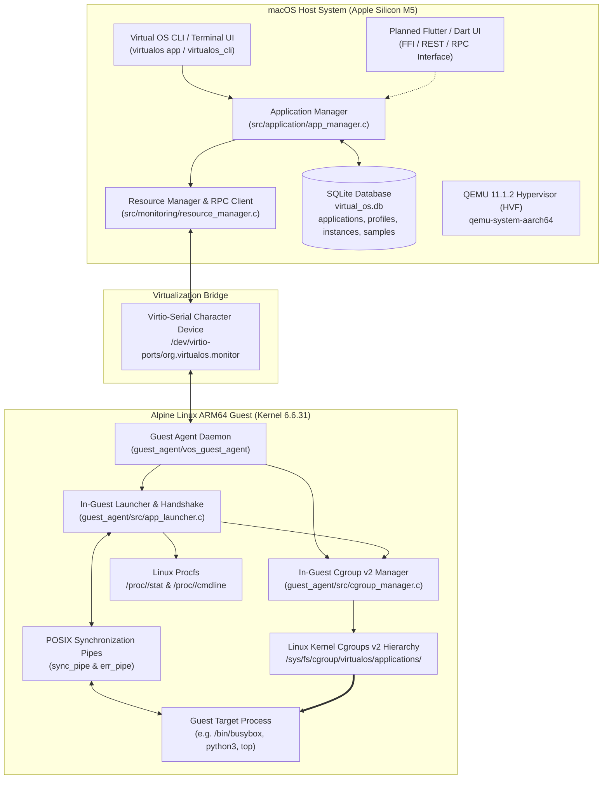
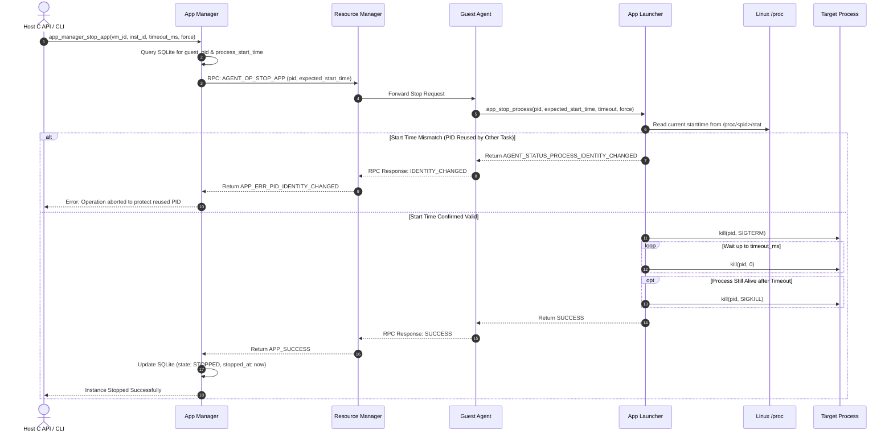

# Phase 5 System Architecture: Application Management and In-Guest Virtualization

**Project**: Virtual OS Simulator  
**Host Architecture**: macOS Apple Silicon M5 (`arm64`)  
**Hypervisor**: QEMU 11.1.2 with HVF Acceleration  
**Guest Environment**: Alpine Linux ARM64 (Linux Kernel `6.6.31-0-lts`)  
**Status**: APPROVED & IMPLEMENTED  

---

## 1. Architectural Overview

Phase 5 establishes a layered, fault-tolerant control architecture linking the Host application manager, SQLite persistence, hypervisor transport, and in-guest Linux kernel enforcement subsystems.



---

## 2. Core Subsystem Components

### 2.1 Host Application Manager (`src/application/app_manager.c`)
The central orchestrator running on macOS host.
* **Registry Management**: Handles per-VM cataloging of executables, category assignment, versioning, and default profile mapping.
* **Profile Engine**: Stores resource boundary specifications, maps high-level allocations (e.g. CPU cores, RAM MB) to kernel cgroups v2 syntax, and guards profiles against in-use deletion.
* **Instance Tracking**: Maintains the lifecycle state (`REGISTERED`, `STARTING`, `RUNNING`, `STOPPING`, `STOPPED`, `FAILED`) of every execution instance with exact process start times.
* **Time-Series Persistence**: Stores point-in-time telemetry records (`cpu_usage_pct`, `throttled_usec`, `memory_current_bytes`, `pids_current`) for historical analysis and UI plotting.

### 2.2 Wire Protocol Layer (`src/monitoring/agent_protocol.c`)
JSON-based request/response serialization over virtio-serial channels.
* Provides deterministic message formatting with explicit length prefixes.
* Decouples the host C API from the guest agent runtime.
* Encapsulates operation opcodes, capability discovery, and extended error reporting.

### 2.3 Guest Agent Daemon (`guest_agent/vos_guest_agent`)
A lightweight, pure C daemon running inside the guest Linux environment.
* Listens on `/dev/virtio-ports/org.virtualos.monitor`.
* Mounts and controls the cgroups v2 unified filesystem at `/sys/fs/cgroup`.
* Manages subtrees under `/sys/fs/cgroup/virtualos/applications/<group_id>/`.
* Executes safe executable discovery, process launching, metrics collection, and termination.

### 2.4 Application Launcher & Synchronizer (`guest_agent/src/app_launcher.c`)
Implements the pre-execution handshake protocol.
* **Pipes**: Utilizes `sync_pipe` to block child execution and `err_pipe` to communicate execve errors back to the agent parent.
* **Procfs Inspection**: Extracts exact kernel `starttime` (field 22 of `/proc/<pid>/stat`) immediately after fork.
* **Cgroup Attachment**: Enforces `echo <pid> > cgroup.procs` and performs readback confirmation before sending the release token.

---

## 3. Interaction Sequences

### 3.1 Pre-Execution Application Launch Sequence

```mermaid
sequenceDiagram
    autonumber
    actor Host as Host C API / CLI
    participant AM as App Manager (Host)
    participant RM as Resource Manager (Host)
    participant GA as Guest Agent (Alpine)
    participant AL as App Launcher (Guest)
    participant CG as Cgroups v2 Kernel
    participant PR as Linux /proc
    participant CH as Child Process

    Host->>AM: app_manager_launch_app(vm_id, app_id, args)
    AM->>AM: Query DB for app path & profile limits
    AM->>RM: resource_manager_create_group(cgroup_name)
    RM->>GA: RPC: AGENT_OP_CREATE_GROUP
    GA->>CG: mkdir /sys/fs/cgroup/.../app_<id>
    GA-->>RM: RPC Response: SUCCESS
    AM->>RM: Enforce limits (cpu.max, memory.max, pids.max)
    RM->>GA: RPC: AGENT_OP_SET_CPU / SET_MEM / SET_PIDS
    GA->>CG: write cpu.max, memory.max, pids.max
    GA-->>RM: Limits applied & verified

    AM->>RM: RPC: AGENT_OP_LAUNCH_APP
    RM->>GA: Forward Launch Request
    GA->>AL: app_launch_process(cgroup_name, exec_path, args)
    AL->>AL: pipe(sync_pipe); pipe(err_pipe)
    AL->>CH: fork()
    Note over CH: Child in fork():<br/>close unused pipe ends<br/>read(sync_pipe[0]) BLOCKS
    AL->>PR: Read /proc/<child_pid>/stat (field 22: starttime)
    AL->>CG: echo <child_pid> > cgroup.procs
    AL->>CG: Read back cgroup.procs to confirm membership
    alt Cgroup Attachment Failed
        AL->>CH: kill(child_pid, SIGKILL)
        AL-->>GA: Return AGENT_STATUS_CGROUP_ATTACH_FAILED
    else Cgroup Attachment Confirmed
        AL->>CH: write(sync_pipe[1], 'G') [RELEASE CHILD]
        Note over CH: Child unblocks<br/>execv(exec_path, argv)<br/>Runs inside cgroup boundaries!
        AL-->>GA: Return child_pid & start_time
    end
    GA-->>RM: RPC Response: SUCCESS (PID, start_time)
    RM-->>AM: Launch Result
    AM->>AM: Insert instance into SQLite (state: RUNNING)
    AM-->>Host: Instance ID & PID
```

### 3.2 Graceful Process Stop & PID Verification Sequence



---

## 4. Concurrency and Thread Safety

1. **Host-Side Concurrency**:
   - `app_manager.c` protects all SQLite database operations, prepared statements, and memory caches with a global mutex `s_app_mutex`.
   - RPC calls to `resource_manager_rpc()` use independent socket descriptors protected by `vm_monitor` mutex locks, guaranteeing zero cross-thread interleaving.
2. **Guest-Side Concurrency**:
   - The guest agent runs a non-blocking event loop using `poll()` over the virtio-serial port.
   - Child processes spawned by the launcher run as independent Linux processes under standard CFS task scheduling.
   - Cgroup accounting files (`cpu.stat`, `memory.current`, `pids.current`) are maintained locklessly in kernel space.

