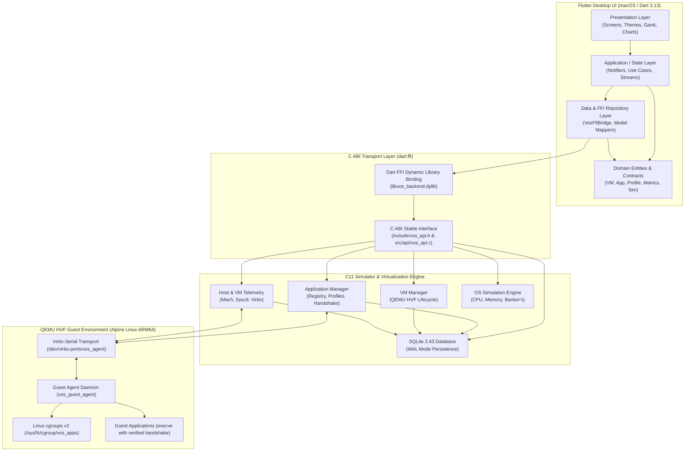

# Phase 6 Architecture — Flutter Frontend & Complete System Integration

**Project**: Virtual OS Simulator  
**Host Platform**: macOS Apple Silicon M5 (`arm64`), Darwin Kernel  
**Hypervisor**: QEMU 11.1.2 with HVF Acceleration  
**Guest OS**: Alpine Linux v3.20 ARM64 (`aarch64`, Linux 6.6.31-0-lts)  
**Backend**: Pure C11 (Clang/GCC), SQLite 3.43 (WAL mode)  
**Frontend**: Flutter 3.47.8 / Dart 3.13.7 (Desktop macOS target)  
**Inter-Layer Bridge**: High-Performance Dart FFI (`dart:ffi`) + Shared Library (`libvos_backend.dylib`)  

---

## 1. System Topology & Architectural Layers

---

## 2. Layer Responsibilities & Clean Architecture

### 2.1 Presentation Layer (`frontend/lib/presentation/`)
- **Dashboard Screen**: Unified high-level overview featuring host telemetry, active QEMU instances, registered and running guest applications, enforcement status, and system health status.
- **VM Management Screen**: Full CRUD operations for virtual machines, QEMU configuration editor, hardware quota controls (vCPUs, RAM, disk images), start/stop/force-kill controls, and guest agent heartbeat.
- **Application Management Screen**: Host-to-guest executable discovery browser, application registration wizard, profile association, launch controls with argument configuration, live process tracking with PID and verified start-time, and graceful/forced stop controls.
- **Resource Profiles Screen**: Cgroup limit designer (CPU quota `cpu.max`, CPU weight `cpu.weight`, Memory limit `memory.max`, Process limit `pids.max`, Disk I/O bandwidth `io.max`), with dynamic block device resolution and explicit marking of GPU limits as **Unsupported**.
- **Live Monitoring Screen**: Real-time telemetry dashboard with four segregated metric layers (Host OS vs QEMU Process vs Guest OS vs Application Cgroup), range pickers (5m, 15m, 1h, 24h), and visual telemetry integrity badges (`FRESH`, `VERIFIED`, `CONTRADICTION`).
- **OS Algorithm Simulator Screen**: Educational and algorithmic workbench for classic OS algorithms (FCFS, SJF, SRTF, Priority, Round Robin, First Fit, Best Fit, Worst Fit, and Banker's Algorithm) with interactive Gantt charts and step-by-step memory allocation maps. **Prominently badges as a theoretical simulation isolated from real VM scheduling.**
- **Database & Audit Logs Screen**: Searchable, filterable event timeline backed by SQLite with full lifecycle traceability.

### 2.2 Application / State Layer (`frontend/lib/application/`)
- Implements state holders via standard Dart `ChangeNotifier` / `ValueNotifier` patterns with deterministic state transitions.
- Dispatches user intents to domain use cases and exposes stream-based polling controllers (e.g. 1s telemetry tickers).

### 2.3 Domain Layer (`frontend/lib/domain/`)
- Pure Dart entities (`VmModel`, `AppEntry`, `AppInstance`, `ResourceProfile`, `HostTelemetry`, `GuestTelemetry`, `SchedSimulation`, `MemSimulation`, `BankerSimulation`, `AuditLogEntry`).
- Strict validation rules (e.g. rejecting invalid cgroup names, vCPU bounds, or negative memory quotas).

### 2.4 Data & FFI Layer (`frontend/lib/data/`)
- `vos_ffi_bridge.dart`: Low-level `dart:ffi` bindings resolving symbols from `libvos_backend.dylib`.
- Manages memory allocation (`calloc`, `free`), UTF-8 string marshaling, and struct/JSON deserialization.
- Repositories implementing domain interfaces.

### 2.5 C ABI Gateway (`include/vos_api.h`, `src/api/vos_api.c`)
- Exposes stable `extern "C"` functions with C linkage.
- Returns structured JSON payloads or integer error codes.
- Guards all operations with database transactions and mutex locks (`pthread_mutex_t`).
- Ensures zero crash propagation into Dart VM: all errors are trapped, sanitized, and returned as descriptive error strings.

---

## 3. Telemetry Segregation Contract

To prevent host-versus-guest contamination, telemetry streams are strictly segregated:

| Metric Dimension | Collection Source | Attribution Label | Integrity Flag |
| :--- | :--- | :--- | :--- |
| **Host Resource Usage** | macOS `mach_host_self()`, `sysctl`, Mach VM API | `HOST (macOS Darwin)` | `HOST_NATIVE` |
| **QEMU Process Footprint** | macOS `proc_pidinfo()`, `libproc` | `VIRTUALIZATION (QEMU HVF)` | `HOST_PROCESS` |
| **Guest OS Utilization** | Alpine `/proc/stat`, `/proc/meminfo`, `/proc/diskstats` | `GUEST OS (Linux 6.6)` | `GUEST_PROC_READBACK` |
| **Application Cgroup** | Alpine `/sys/fs/cgroup/vos_apps/<group>/` | `CGROUP_V2 (Per-App)` | `CGROUP_V2_ENFORCED` |

---

## 4. Concurrency & Threading Model

1. **Dart Main UI Thread**: Handles 60/120 FPS rendering and user interactions.
2. **Dart Async Telemetry Worker**: Timer-based polling loop (1000ms) calling FFI C functions asynchronously or via background isolates (`compute()`), preventing UI frame drops.
3. **C Engine Internal Worker Threads**: VM monitoring thread (`vm_monitor.c`) continues periodic background sampling and writes samples into SQLite WAL tables without blocking UI reads.
4. **SQLite Concurrency**: SQLite configured in `WAL` mode (`PRAGMA journal_mode=WAL`) allowing simultaneous multi-reader execution without lock contention.

