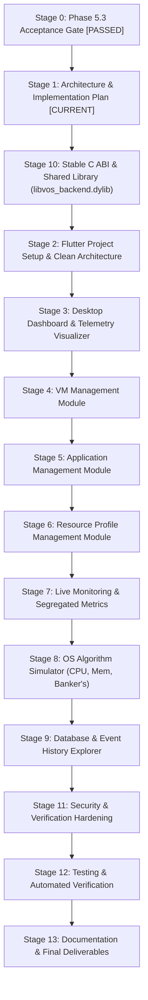

# Phase 6 Implementation Plan — Step-by-Step Delivery Roadmap

**Project**: Virtual OS Simulator  
**Host Architecture**: macOS Apple Silicon M5 (`arm64`)  
**Frontend Framework**: Flutter 3.47.8 / Dart 3.13.7 (Desktop macOS)  
**Backend Framework**: C11, Clang, SQLite 3.43  
**Status**: IN EXECUTION (Stage 0 Passed, Stage 1 In Progress)  

---

## 1. Execution Stages & Dependencies

---

## 2. Detailed Task Breakdown

### Stage 10: Stable C ABI & Shared Dynamic Library (`libvos_backend.dylib`)
- Create `include/vos_api.h` declaring high-level C-ABI entry points returning JSON strings or typed structs.
- Create `src/api/vos_api.c` implementing:
  * System initialization & teardown (`vos_api_init`, `vos_api_shutdown`).
  * Host telemetry retrieval (`vos_api_get_host_telemetry`).
  * Virtual machine management (`vos_api_vm_list`, `vos_api_vm_start`, `vos_api_vm_stop`, `vos_api_vm_create`, `vos_api_vm_delete`).
  * In-guest application operations (`vos_api_app_discover`, `vos_api_app_register`, `vos_api_app_launch`, `vos_api_app_stop`, `vos_api_app_list`, `vos_api_app_metrics`).
  * Resource profiles CRUD (`vos_api_profile_list`, `vos_api_profile_save`, `vos_api_profile_delete`).
  * Algorithm simulator engine (`vos_api_sim_run_scheduler`, `vos_api_sim_run_memory`, `vos_api_sim_run_bankers`).
  * Event audit log queries (`vos_api_events_list`).
- Update `Makefile` to compile dynamic shared library `build/libvos_backend.dylib` for macOS (`-shared -fPIC -dynamiclib`).
- Verify shared library symbol exports with `nm` or `otool`.

### Stage 2: Flutter Project Setup & Clean Architecture Foundation
- Initialize Flutter macOS desktop project inside `frontend/` directory.
- Configure `frontend/pubspec.yaml` with essential packages (`ffi`, `path`, `provider`, `intl`, `fl_chart` or custom canvas charts).
- Establish folder structure:
  * `lib/core/` (theme, colors, formatting, errors)
  * `lib/domain/` (entities, value objects, interfaces)
  * `lib/data/` (FFI bindings, C-API client, repository implementations)
  * `lib/application/` (state providers, use cases, polling controllers)
  * `lib/presentation/` (views, screens, navigation)
  * `lib/widgets/` (reusable metric cards, gauges, charts, Gantt canvas)
- Implement `lib/data/ffi/vos_ffi_bridge.dart` for dynamic library loading and pointer management.

### Stage 3: Desktop Dashboard Screen
- Implement top-level system health overview.
- Cards displaying host CPU/RAM, active QEMU hypervisor instance count, running guest apps, and enforcement alerts.
- Live telemetry sparkline graphs with continuous updates.
- Fast navigation shortcuts to VM, App, Profile, and Simulator views.

### Stage 4: Virtual Machine Management Screen
- VM list view with state badges (`STOPPED`, `STARTING`, `RUNNING`, `FAILED`).
- VM detail panel showing vCPU count, memory, disk image path, console log output.
- Actions: Start VM, Graceful Shutdown (SIGTERM), Force Kill (SIGKILL), Configure VM.
- Hardware validation before QEMU launch.

### Stage 5: Application Management Screen
- In-guest executable discovery browser: triggers `AGENT_OP_DISCOVER_APPS` and lists `/bin`, `/usr/bin`, etc.
- Registration dialog: name, executable path, category, description, assigned resource profile.
- App launcher: launch with argument string, pre-execution cgroup verification, real-time feedback.
- Running instances table: PID, start-time, cgroup path, state, uptime, memory, CPU %.
- PID reuse-safe termination button (invokes `STOP_APP` with verified start-time).

### Stage 6: Resource Profile Management Screen
- Profile list showing predefined and custom profiles (`default`, `restricted`, `high_perf`, etc.).
- Resource limit editor:
  * CPU quota (`cpu.max`) & weight (`cpu.weight`).
  * Memory ceiling (`memory.max`).
  * PIDs ceiling (`pids.max`).
  * Disk I/O bandwidth (`io.max` rbps/wbps) with dynamic device resolution.
  * GPU support: explicitly flagged and rendered as **"Unsupported (Host Apple Silicon / Guest Headless Linux)"**.
- In-use protection: preventing deletion of profiles currently bound to registered apps.

### Stage 7: Live Monitoring & Segregated Metrics Screen
- Dedicated real-time monitoring view with four isolated layers:
  1. Host macOS (Darwin Mach/Sysctl)
  2. QEMU Process (macOS RSS & Process CPU)
  3. Guest Linux Kernel (procfs vCPU & Mem)
  4. Application Cgroup (cgroup v2 consumption & throttling)
- Time-range selector (5m, 15m, 1h, 24h) pulling historical records from SQLite.
- Telemetry integrity indicators (`FRESH`, `VERIFIED`, `CONTRADICTION`).

### Stage 8: OS Algorithm Simulator Screen
- Simulation workbench with clean separation from real VM scheduling:
  * **CPU Scheduling**: FCFS, SJF, SRTF, Priority, Round Robin (custom quantum). Interactive Canvas-rendered Gantt chart, process metric table (turnaround, waiting, response times).
  * **Memory Management**: First Fit, Best Fit, Worst Fit algorithms. Visual memory block layout, allocation map, internal/external fragmentation indicators.
  * **Banker's Algorithm**: Safety algorithm verification, allocation/max/available matrices, safe execution sequence computation.
- Educational tooltips and algorithmic explanations.

### Stage 9: Database & Event History Screen
- Historical audit log table queried directly from SQLite (`application_events`, `vm_events`).
- Filter by VM ID, event type (`LAUNCH`, `STOPPED`, `CGROUP_LIMIT`, `RECONCILED`), and date range.
- Full event payload inspector.

### Stage 11–13: Verification, Testing & Final Documentation
- Run integration tests connecting Flutter FFI to C backend.
- Run complete regression suite `make test_all` (963 checks).
- Produce deliverables:
  * `docs/PHASE_6_IMPLEMENTATION_REPORT.md`
  * `docs/PHASE_6_TEST_RESULTS.md`
  * `docs/FLUTTER_SETUP.md`
  * `docs/USER_GUIDE.md`

